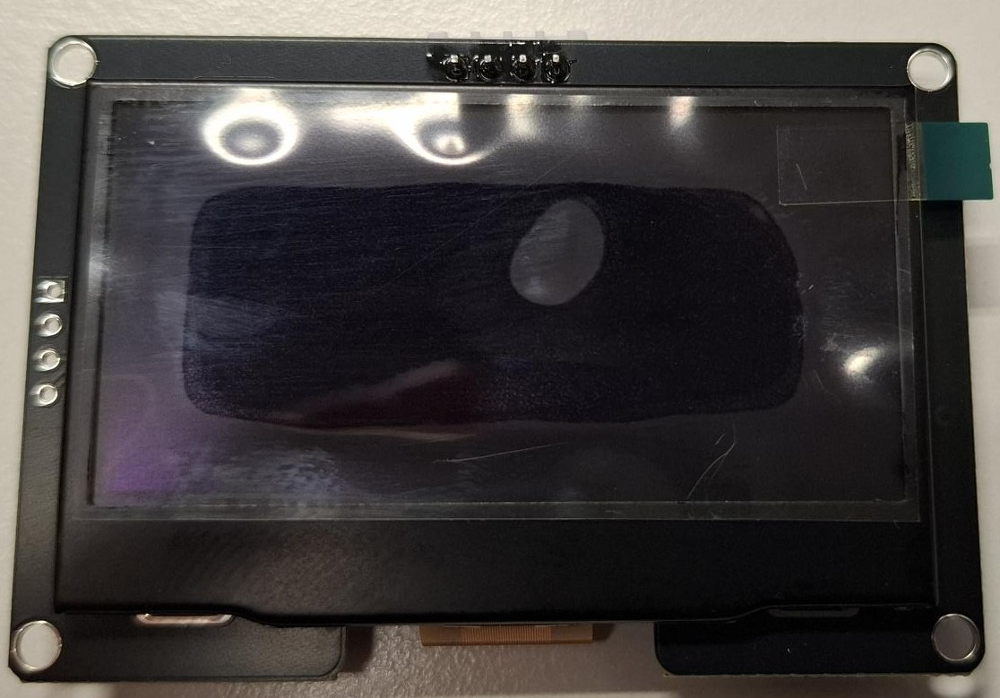
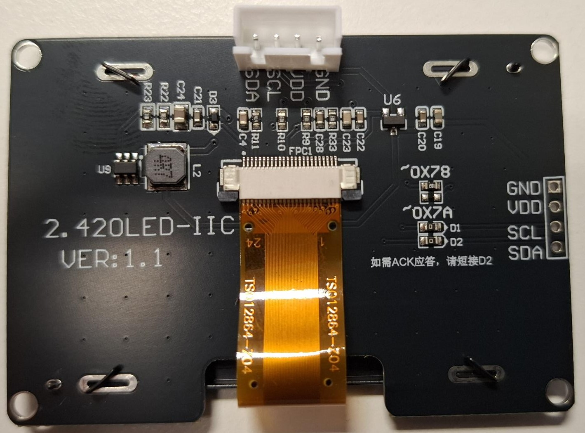

# SSD1309 OLED 128x64 for BBC micro:bit V2

Microsoft MakeCode extension for controlling a 128x64 monochrome OLED display based on the SSD1309 controller using I2C.

## Hardware photos

| Front view | Back view |
|---|---|
|  |  |

## Features

- SSD1309 OLED initialization
- 128x64 monochrome graphics
- 1024-byte framebuffer
- Individual pixel control (ON/OFF)
- Immediate pixel updates without refreshing the entire display
- Horizontal and vertical lines
- Rectangles and filled rectangles
- Squares and filled squares
- Circles and filled circles
- Text using a scalable 5x7 font
- Number display
- Clear and fill framebuffer
- Full display refresh
- Brightness adjustment
- Display ON/OFF
- Inverted display mode

## Hardware connections

| OLED pin | BBC micro:bit V2 |
|---|---|
| VDD | 3V |
| GND | GND |
| SDA | P20 |
| SCL | P19 |

Default I2C address: `0x3C`

Use a 3.3V-compatible OLED module and I2C pull-up configuration.

## Installation

1. Open [Microsoft MakeCode for micro:bit](https://makecode.microbit.org/).
2. Create a new project.
3. Select **Extensions**.
4. Search for:

   `https://github.com/pawelkasprowicz/ssd1309-oled`

5. Add the extension to your project.

## Example — graphics

```typescript
ssd1309.init()
ssd1309.clear()

ssd1309.rectangle(0, 0, 128, 64, false)
ssd1309.circle(64, 32, 20, true)
ssd1309.text("HELLO", 10, 10, 1)

ssd1309.show()
```

## Example — immediate pixel update

```typescript
ssd1309.init()

// Turn a pixel ON immediately
ssd1309.pixel(50, 30, true, true)

// Turn the same pixel OFF immediately
ssd1309.pixel(50, 30, false, true)
```

The final parameter controls immediate updating:

- `true` — update the OLED immediately.
- `false` — update the framebuffer only; call `show()` later.

## Performance measurements

Measured on BBC micro:bit V2 with an SSD1309 128x64 I2C OLED:

| Operation | Average time |
|---|---:|
| Turn on 128 pixels individually, immediate mode | 190.6 ms |
| Turn off 128 pixels individually, immediate mode | 190.2 ms |
| Draw 128 pixels in framebuffer and refresh | 134.6 ms |
| Clear 128 pixels in framebuffer and refresh | 134.6 ms |
| Full display refresh | 130.6 ms |

Measurements are approximate and depend on hardware and I2C communication overhead.

## Compatibility

- BBC micro:bit V2
- Microsoft MakeCode
- SSD1309 128x64 I2C OLED
- Tested with a 2.42-inch OLED module

## Version

v1.0.0

## Author

Paweł Kasprowicz

## License

See the repository license file, if provided.
